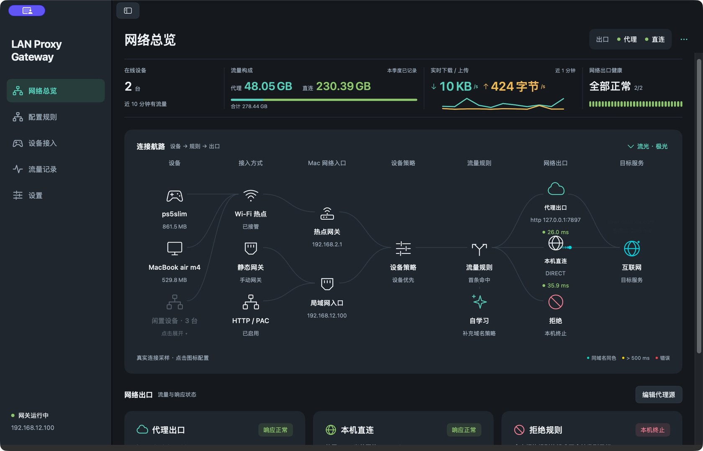
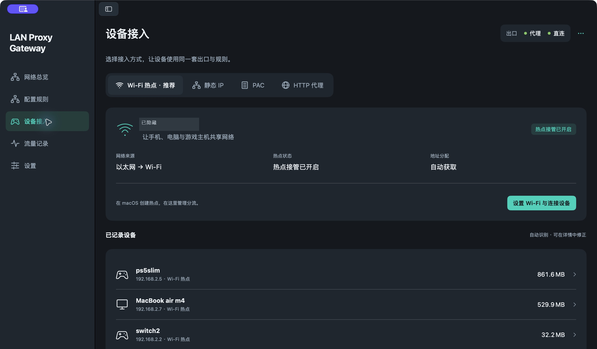

# LAN Proxy Gateway

**把电脑上已有的代理，共享给手机、电视和游戏机。**

在 Mac 上打开 App、设置代理出口，再让设备连接 Mac 的 Wi-Fi 热点，就可以统一查看连接、统计流量和管理分流。设备端无需安装本项目。

**[下载最新版](https://github.com/Tght1211/lan-proxy-gateway/releases/latest) · [跟着图文手册开始](docs/user-guide.md) · [安装包怎么选](docs/download.md) · [English](README_EN.md)**

*网络总览会显示接入设备、代理与直连用量，以及设备到出口的连接路径。[截图说明](docs/images/manual/README.md)。*

## 先确认你需要什么

- 一台保持开机、联网的 **Mac 或 Linux 电脑**，作为共享网络的主机。macOS 有图形 App，Linux 使用命令行。
- 已经能用的 **HTTP / SOCKS5 代理**，例如 Clash、Mihomo 或 sing-box 提供的本地端口。本项目不提供节点或订阅。
- 想用最省心的 Wi-Fi 热点方式：**Mac 通过网线上网，并且具备 Wi-Fi**。设备连这个热点，地址自动分配。

Mac 只有 Wi-Fi、暂时没有网线？先用 [HTTP 代理方式](docs/user-guide.md#http)，让支持代理设置的手机或浏览器接入。游戏机或需要透明转发的设备可按 [静态网关教程](docs/user-guide.md#static) 配置。

## 第一步：下载哪个文件？

去 [Release 下载页](https://github.com/Tght1211/lan-proxy-gateway/releases/latest)，展开 **Assets（附件）**。按**运行网关的电脑**选，不是按手机或游戏机选。

| 你的设备 / 用途 | 下载这个 | 如何使用 |
|---|---|---|
| **Mac，第一次使用（推荐）** | **`LANProxyGateway-v版本号-macos-universal.dmg`** | macOS 13+；M 系列与 Intel 通用，打开后拖入“应用程序” |
| Linux 电脑，Intel / AMD 64 位 CPU | `gateway-linux-amd64.tar.gz` | 命令行版本，见 [Linux 安装](docs/download.md#linux) |
| Linux 电脑，ARM 64 位系统 | `gateway-linux-arm64.tar.gz` | 命令行版本，先用 `uname -m` 确认架构 |
| 手机、平板、PS5、Switch、Apple TV、电视 | **不用下载安装包** | 连接已配置好的网关网络 |
| Windows 电脑作为网关主机 | 暂无安装包 | 当前不支持 Windows 宿主 |

Mac 用户下载 DMG 就够了。`gateway-darwin-*` 是给命令行用户的；`skill.zip` 是可选的 AI Agent 扩展；`Source code` 是源代码。更多附件见 [完整对照表](docs/download.md)。

## 第二步：按顺序接通第一台设备

以下主线适用于 **网线上网的 Mac → Wi-Fi 热点 → 手机 / 游戏机**。

1. **安装 App。** 打开 DMG，把 LAN Proxy Gateway 拖入“应用程序”，再从“应用程序”打开。首次启动核心时按提示完成管理员授权。
2. **设置已有代理。** 在“网络总览”点击“编辑代理源”，填写代理软件的实际类型、地址和端口，点击“测试代理”，成功后“应用代理”。[填写示例](docs/user-guide.md#upstream)
3. **创建并接管热点。** 打开“设备接入 → Wi-Fi 热点 · 推荐 → 设置 Wi-Fi 与连接设备”。按向导在 macOS 开启“以太网 → Wi-Fi”的互联网共享，再回 App 开启热点接管。[逐步截图](docs/user-guide.md#wifi)
4. **连接并验证。** 手机或游戏机连接刚创建的热点；IP、DNS 自动获取，设备代理关闭。打开网页或商店，再看“流量记录”里有没有这台设备的新连接。[成功检查](docs/user-guide.md#verify)

**完成这四步就可以使用。** 规则、自学习、CLI 和 Agent 都可以以后再了解。截图里的 IP、端口和流量是示例环境，填写时以你自己的 App 为准。

## 接通后，可以做什么？

| 你想做的事 | 在哪里操作 |
|---|---|
| 看谁在联网、用了多少代理流量 | 网络总览；设备接入中点击设备 |
| 让某台设备走直连或代理 | 设备详情中的设备策略 |
| 让某个网站走代理、直连或拒绝 | 配置规则 → 分流规则 |
| 自动记录直连失败、代理可达的网站 | 配置规则 → 自学习，或流量记录 → 自动学习 |
| 排查某个网站打不开 | 流量记录按设备、域名、结果筛选 |
| 更新软件、设置开机自启 | 设置 → 版本与更新 / 通用 |

[完整使用手册](docs/user-guide.md) 包含其他接入方式、规则管理、更新、停止与恢复网络；[常见问题](docs/faq.md) 按症状排查。

## 使用前知道这些就够了

- Mac / Linux 主机及上游代理要保持运行。退出 App 窗口不等于停止后台核心。
- Wi-Fi 热点和静态网关是两种不同的透明接入模式，切换会影响现有设备；HTTP / PAC 可同时开启。
- 主要代理 IPv4 TCP。HTTP / PAC 只覆盖遵循代理设置的应用；游戏、语音等 UDP 不提供通用代理，不能保证改变 NAT 类型或改善联机延迟。
- 支持一个 HTTP/SOCKS5 上游，节点选择交给上游软件；能否访问特定服务取决于上游、分流和目标服务。
- 流量统计只覆盖经过本网关的转发，不等于设备全部流量或代理服务商账单。当前不支持 Windows / OpenWrt 宿主、IPv6 透明代理。

## 文档与开发

[文档目录](docs/README.md) · [App 功能参考](docs/app.md) · [命令行](docs/commands.md) · [Agent Skill](docs/agent-skill.md) · [配置](docs/advanced.md) · [架构](docs/architecture.md) · [更新记录](CHANGELOG.md)

普通使用只需下载 Release。参与开发时查看 [构建说明](docs/app.md#build)；文档中的功能以 [发布版本](https://github.com/Tght1211/lan-proxy-gateway/releases/latest) 为准，源码分支可能与发布标签不同。

[MIT License](LICENSE)
