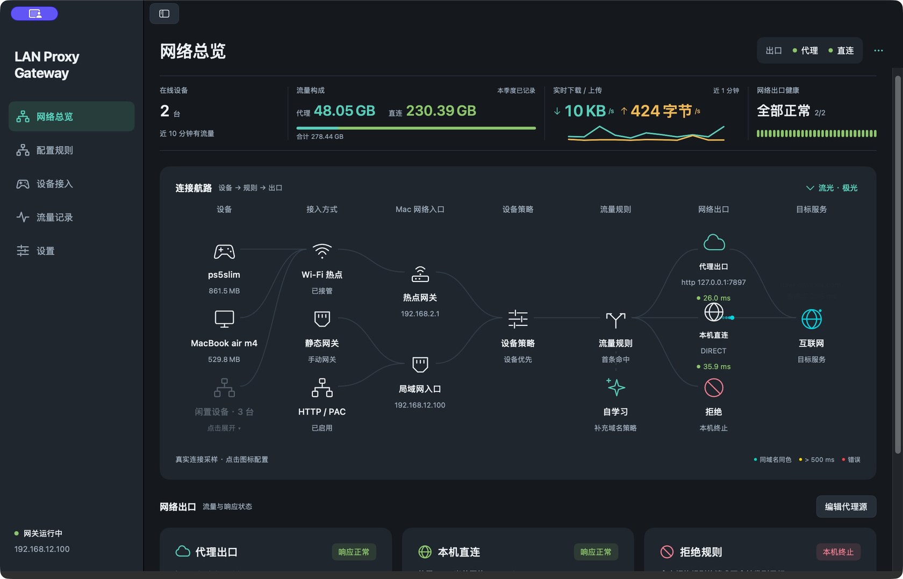
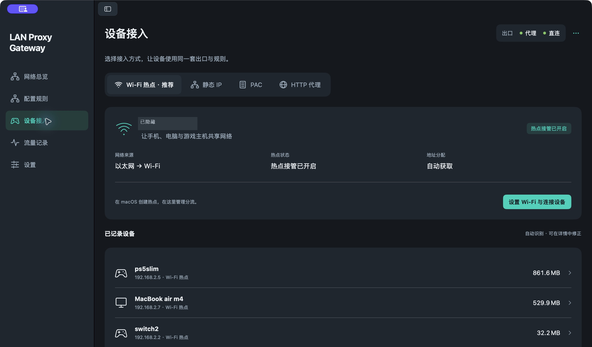

# LAN Proxy Gateway

**Share an existing proxy on your computer with phones, TVs, and game consoles.**

Configure your upstream in the Mac app, connect a device to the Mac's Wi-Fi hotspot, and manage routing and traffic in one place. Client devices do not install this project.

**[Download](https://github.com/Tght1211/lan-proxy-gateway/releases/latest) · [Illustrated manual (Chinese)](docs/user-guide.md) · [中文](README.md)**

## What you need

- A Mac or full Linux computer that stays powered on and connected. macOS has a graphical app; Linux uses the CLI.
- A working HTTP/SOCKS5 upstream, such as the local proxy port exposed by Clash, Mihomo, or sing-box. This project does not provide nodes or subscriptions.
- For the recommended hotspot route: an Ethernet-connected Mac with Wi-Fi available for sharing.

## Choose the right download

Open the latest Release and expand **Assets**. Choose for the **computer running the gateway**, not for the phone or console.

| Device / purpose | Download | Installation |
|---|---|---|
| **Mac, graphical app (recommended)** | **`LANProxyGateway-vVERSION-macos-universal.dmg`** | macOS 13+; both Apple Silicon and Intel. Drag the app into Applications |
| Linux, Intel / AMD 64-bit | `gateway-linux-amd64.tar.gz` | CLI; see the [installation guide](docs/download.md#linux) |
| Linux, ARM 64-bit | `gateway-linux-arm64.tar.gz` | CLI; verify the OS architecture with `uname -m` |
| Phone, tablet, PS5, Switch, Apple TV, TV | **No download** | Connect to the configured gateway network |
| Windows as the gateway host | Not available | Windows hosting is currently unsupported |

Mac CLI users can choose `gateway-darwin-arm64` or `gateway-darwin-amd64`, with or without `.tar.gz`. `darwin` means macOS; `amd64` also covers Intel x86-64. Download either the archive or the executable, not both. The optional Skill ZIP is for AI agents; Source code is for developers; SHA256SUMS is a checksum list.

## Connect your first device

For **Ethernet-connected Mac → Wi-Fi hotspot → client device**:

1. **Install.** Open the universal DMG, drag LAN Proxy Gateway to Applications, and launch it there. If stopped, use the top-right **… → 启动核心** (Start core). Complete the administrator prompt when needed.
2. **Configure the upstream.** In **网络总览** (Overview), choose **编辑代理源** (Edit proxy source). Enter the actual protocol, host, and port from your proxy software. Test, then apply. `127.0.0.1:7897` is only an example.
3. **Create and take over the hotspot.** Open **设备接入 → Wi-Fi 热点 · 推荐 → 设置 Wi-Fi 与连接设备**. In macOS Internet Sharing, share Ethernet over Wi-Fi, configure the Wi-Fi options, and enable sharing. Return to the app and enable hotspot takeover.
4. **Connect and verify.** Join the new Wi-Fi network on the client. Keep IP and DNS automatic and client proxy settings off. Open a website or store, then check that the device produces new entries in **流量记录** (Connections).

The app's Wi-Fi name/password fields are a **memo**. Actual hotspot settings must be entered in macOS Internet Sharing. “Takeover enabled” confirms the core applied its rules; verify the website or game on the client as well.

The screenshots show an already configured installation, not a clean first launch. Addresses, ports, and counters are examples. [Capture notes](docs/images/manual/README.md).

## Other access methods

Choose one route for initial setup; do not combine their client instructions.

| Method | When to use it | Client configuration |
|---|---|---|
| Wi-Fi hotspot | Ethernet-connected Mac | Join the Mac hotspot; automatic IP/DNS, proxy off |
| HTTP proxy / PAC | Apps that honor proxy settings, including when the Mac has no Ethernet | Enable and save the gateway's HTTP listener; enter its LAN address and port or PAC URL. Keep existing IP/gateway/DNS |
| Static gateway | Transparent access on an existing LAN, Mac or Linux host | Reserve a free client IP in the actual subnet; point its gateway at the host and configure gateway DNS as required |

The HTTP listener defaults to port **17894**. It is separate from the **upstream proxy port**. The screenshots use a customized listener port, 17890. On another device, `127.0.0.1` refers to that device itself; use the gateway computer's LAN IP.

[HTTP steps](docs/user-guide.md#http) · [PAC](docs/user-guide.md#pac) · [Static gateway](docs/user-guide.md#static)

## After setup

Use Overview for health and usage, Device Access for individual devices, Connections for actual routing/results, Rules for domain/device policies and automatic learning, and Settings for startup, updates, logs, CLI and Agent Skill.

[Daily management](docs/user-guide.md#daily) · [Update app and core](docs/user-guide.md#update) · [Stop and restore networking](docs/user-guide.md#stop) · [Troubleshooting](docs/faq.md)

## Scope

- One HTTP/SOCKS5 upstream. Keep the upstream software running; node selection belongs there.
- Primarily IPv4 TCP. HTTP/PAC only handles applications that honor proxy settings. No general UDP proxy or guaranteed NAT/latency improvement for games.
- Hotspot and static gateway are alternate transparent access modes; changing modes affects existing clients. HTTP/PAC can run alongside either.
- Traffic totals only cover data forwarded by this gateway, not all device traffic or a provider's bill. Daily aggregates persist; individual connections are limited to 72 hours / 2,000 entries in memory.
- Closing the app window does not stop the background core. Restore client network settings before stopping/uninstalling.
- Windows/OpenWrt hosting and IPv6 transparent proxying are unsupported.

## Documentation and development

[Documentation index](docs/README.md) · [App reference and building](docs/app.md#build) · [CLI](docs/commands.md) · [Agent Skill](docs/agent-skill.md) · [Architecture](docs/architecture.md) · [Changelog](CHANGELOG.md)

For normal use, download a Release. Documentation describes released behavior; source branches may differ from release tags.

[MIT License](LICENSE)
