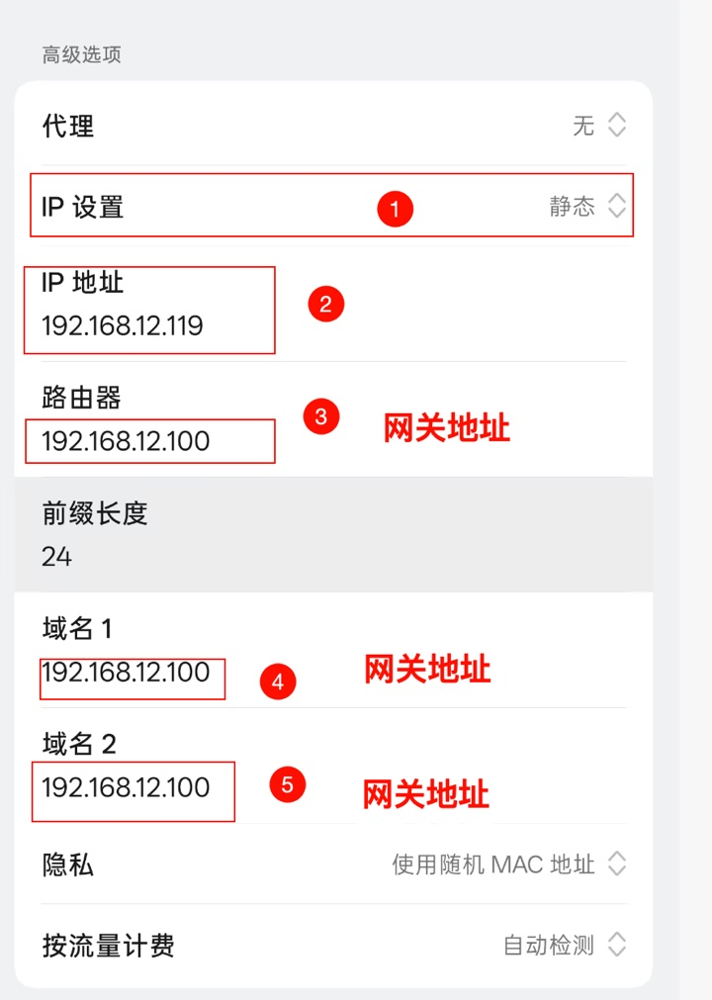

# 手机 / 平板接入

[返回图文手册](user-guide.md) · [先选接入方式](device-setup.md)

手机不安装 LAN Proxy Gateway。先在电脑上完成代理设置，再选择下面一种路线。

## 推荐：连接 Mac 热点

在有线 Mac 完成 [热点创建和接管](user-guide.md#wifi) 后：

1. 手机打开“设置 → Wi-Fi / WLAN”，选择 Mac 创建的热点并输入密码。
2. IP 和 DNS 自动获取；代理设为无/关闭。
3. 打开网页，再在电脑“流量记录”中确认这台手机的新连接。

以前手动填写过网关或代理时，先改回自动，必要时忘记网络后重连。

## 无需创建热点：HTTP / PAC

先按 [HTTP 服务设置](user-guide.md#http) 保存并启用监听。手机与主机应在可互访的网络中。

| 系统 | 手动 HTTP | PAC 自动代理 |
|---|---|---|
| iPhone / iPad | 设置 → Wi-Fi → ⓘ → 配置代理 → 手动；填电脑局域网 IP、端口和按需认证 | 同处选“自动”，粘贴 App 的 PAC URL |
| Android | 当前 WLAN 的编辑/高级设置 → 代理 → 手动；填主机和端口 | 系统提供自动代理时填写 PAC URL；没有此选项则用手动方式 |

不同 Android 厂商的菜单与认证能力不同。只影响遵循代理设置的应用，IP/网关/DNS 保持原样。`127.0.0.1` 不是手机该填的服务器地址。

## 进阶：静态网关

先完成 [静态网关主机设置及 DNS 检查](user-guide.md#static)。以下只补充设备菜单，不代表所有人都需要修改：

| 系统 | IP 与网关 | DNS |
|---|---|---|
| iPhone / iPad | Wi-Fi → ⓘ → 配置 IP → 手动；填设备空闲 IP、实际掩码，路由器填网关主机 IP | 配置 DNS → 手动；使用网关 DNS 时填主机 IP |
| Android | WLAN → 编辑当前网络 → IP 设置 → 静态；填设备空闲 IP、实际前缀长度，网关填主机 IP | 使用网关 DNS 时，DNS 1 填主机 IP；DNS 2 不允许重复则留空 |

HTTP 代理设为无。DNS/DoH/私人 DNS 会影响域名识别，按主手册核对；`24` 不是所有局域网通用的前缀长度。

*这是旧设备的字段示例，不是默认推荐路线；不要照抄图中的地址。*

## 验证与恢复

[验证步骤](user-guide.md#verify)：网页实际可用，同时在 App 查看新连接和实际出口。国内外网站走什么路径，由本网关规则和上游共同决定。

[停用恢复](user-guide.md#stop)：热点切回原 Wi-Fi；HTTP/PAC 关闭代理；静态网关恢复自动 IP/DNS 或原来的设置。主机关机后不能继续依赖它转发。
