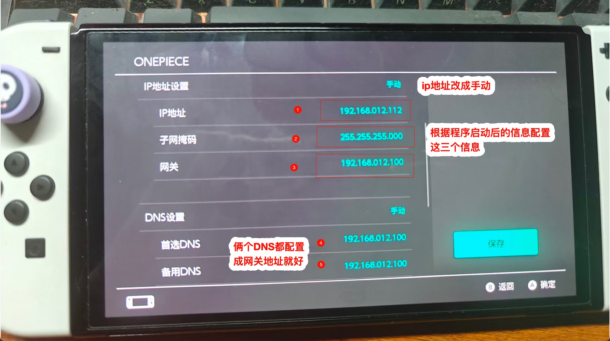

# Nintendo Switch 接入

[返回图文手册](user-guide.md) · [排查游戏联机](faq.md#gaming)

Switch 不安装网关软件。优先使用有线 Mac 的热点路线，避免手填地址。以下为菜单指引，具体名称会因主机型号/系统语言不同而变化。

## 推荐：连接 Mac 热点

1. 在 Mac 完成 [热点创建、代理出口和接管](user-guide.md#wifi)。
2. Switch：**系统设置 → 互联网 → 互联网设置**，选择 Mac 热点，输入密码。
3. IP 地址、DNS 使用自动；代理服务器关闭。
4. 执行连接测试，再实际打开商店或需要使用的功能；在 App 查看设备的新连接。

找不到热点时，检查 macOS 的实际信道与加密兼容设置，见 [热点详细说明](hotspot-setup.md)。不要只在 App 中保存名称备忘。

## 进阶：原 Wi-Fi 的静态网关

先完成 [静态网关主机设置](user-guide.md#static)，确认真实子网、主机 IP 和 DNS 服务。进入 **互联网设置 → 当前网络 → 更改设置**：

| 项目 | 填写 |
|---|---|
| IP 地址设置 | 手动；填写同子网未占用的设备 IP |
| 子网掩码 | 实际网络掩码，不能默认所有网络都是 255.255.255.0 |
| 网关 | 网关电脑的局域网 IP |
| DNS | 使用网关 DNS 时设为手动，首选填主机 IP；备用同值或在不允许重复时留空 |
| 代理服务器 | 关闭 |

*图中的地址是示例，不是你的网络参数。热点路线不用填写这一页的静态地址。*

## 游戏与 NAT

连接测试、商店访问和游戏对战是不同检查。项目主要代理 IPv4 TCP，没有通用游戏 UDP 代理；热点也会增加 NAT 层级。不能保证 NAT 类型、低延迟或所有游戏可联机。遇到问题先与直接连接原路由器作对比，见 [联机排查](faq.md#gaming)。

## 停用

热点路线回到原路由器 Wi-Fi；静态路线把 IP 和 DNS 改回自动，或恢复原网络设置。完整 [恢复说明](user-guide.md#stop)。
