# LAN Proxy Gateway 完整使用手册

[项目首页](../README.md) · [下载与安装包选择](download.md) · [遇到问题](faq.md)

这份手册从“刚下载软件”开始，带你接通第一台设备，再介绍日常管理。**第一次使用，按第 1–4 步走即可；接入方式只选择一种。**

功能以 v4.5.6 发布源码核对，文档核对日期为 2026-11-06。插图由 Computer Use 操作本机应用和系统设置实拍，包含已配置环境；更新示例是本机显示的 v4.5.5 → v4.5.6。截图中的数量、地址和端口无需与你一致，见 [截图来源与处理说明](images/manual/README.md)。

## 跟着你的进度读

| 现在做到哪里 | 下一步 |
|---|---|
| 还没安装 | [1. 安装和准备](#install) |
| 已打开 App | [2. 配置已有代理](#upstream) |
| 代理已经测试成功 | [3. 创建 Wi-Fi 热点并接入](#wifi) |
| 设备连上了 | [4. 验证是否真正接通](#verify) |
| Mac 没有网线 / 不想创建热点 | [HTTP 代理](#http)；支持自动代理的设备也可用 [PAC](#pac) |
| 想在原来的局域网中透明接入 | [静态网关（进阶）](#static) |
| 已经用起来了 | [日常管理](#daily)、[更新](#update)、[停止与恢复](#stop) |
| 使用 Linux / 只用命令行 | [独立安装教程](download.md#linux) |

## 1. 安装和准备

### 1.1 先分清两种设备

**网关主机**是运行 LAN Proxy Gateway 的电脑。**接入设备**是借它联网的手机、平板、游戏机或电视。安装包下载到主机上，接入设备不安装本项目。

推荐主线需要：

- macOS 13 或更新版本的 Mac，Apple Silicon / Intel 均可。
- Mac 用以太网联网；没有网口可使用系统能识别的 USB 网卡。Wi-Fi 用来创建热点。
- 已有代理软件能正常工作，并提供 HTTP 或 SOCKS5 代理端口。
- Mac 保持开机和唤醒，上游代理软件保持运行。

**只有一个用于上网的 Wi-Fi 连接时，不要直接照抄“以太网共享给 Wi-Fi”。** 先走 [HTTP 代理接入](#http)，或准备有线网络后再走热点主线。

### 1.2 安装 Mac App

1. 打开 [最新 Release](https://github.com/Tght1211/lan-proxy-gateway/releases/latest)，展开 Assets。
2. 下载名字以 `LANProxyGateway-` 开头、以 `-macos-universal.dmg` 结尾的文件。M 系列和 Intel 都用这一份。
3. 双击 DMG，将 **LAN Proxy Gateway** 拖到 **Applications / 应用程序**。
4. 从“应用程序”打开 App。不要一直从 DMG 中运行，否则更新时可能无法替换 App。
5. 若左下角显示“网关已停止”，点右上角 **… → 启动核心**。首次运行会初始化配置；系统要求管理员授权时，输入这台 Mac 的管理员凭据。

App 是操作窗口，“核心”是后台负责转发网络的程序。DMG 已带核心，**不必另下 CLI，也不必安装 Go、Xcode 或 Skill**。

**检查点：** 能打开“网络总览”；核心启动后左下角显示“网关运行中”。如果系统阻止打开已下载 App，见 [安装问题](faq.md#open-app)。

## 2. 配置已有代理

### 2.1 找到代理软件提供的端口

先在 Clash、Mihomo、sing-box 等软件里确认代理可用，再找到它提供的 **HTTP、SOCKS5 或混合端口**。订阅链接、网页控制面板地址、API 端口都不能填在这里。

同一台 Mac 上运行代理软件时，地址通常填 `127.0.0.1`；代理在另一台电脑上时，填写那台电脑可从网关主机访问的地址。

### 2.2 在网关中填写并测试

1. 在 **网络总览** 向下找到“网络出口”，点击 **编辑代理源 / 配置代理源**。
2. “出口模式”选择代理软件提供的协议：HTTP CONNECT 或 SOCKS5。
3. 填写“代理地址”和“端口”。例如，只有在你的软件确实监听该端口时，才填写 `127.0.0.1:7897`。
4. 点击 **测试代理**。测试成功后点击 **应用代理**。
5. 回到总览检查代理出口状态。若核心尚未启动，通过右上角 **… → 启动核心** 启动。

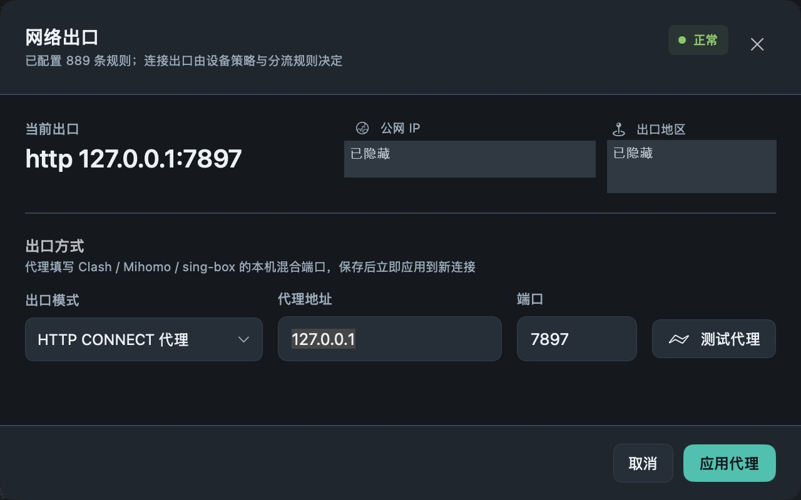

*“测试代理”只测试当前填写值；“应用代理”才保存。公网地址和地区已隐藏。*

### 2.3 两种端口不要混淆

| 名称 | 谁连接它 | 示例 | 去哪里查看 |
|---|---|---|---|
| 上游代理端口 | LAN Proxy Gateway → 你的代理软件 | `127.0.0.1:7897` | 代理软件自己的设置 |
| 局域网 HTTP 代理端口 | 手机 / 浏览器 → LAN Proxy Gateway | `电脑局域网IP:17894` | 设备接入 → HTTP 代理 |

`127.0.0.1` 的意思是“当前这台设备自己”。手机中填 `127.0.0.1` 会连向手机本身；HTTP 接入时应填 App 显示的主机局域网地址。

**检查点：** “测试代理”成功，并已点击“应用代理”。失败时先检查协议、端口、代理软件是否运行及节点是否可用，暂时不要修改其他设备的网络设置。

## 3. 创建 Wi-Fi 热点并接入设备（推荐）

这一节只适用于**有线联网的 Mac**。系统负责创建 Wi-Fi，App 负责让热点流量按规则使用代理或直连。

### 3.1 打开向导

点击 **设备接入 → Wi-Fi 热点 · 推荐 → 设置 Wi-Fi 与连接设备**。

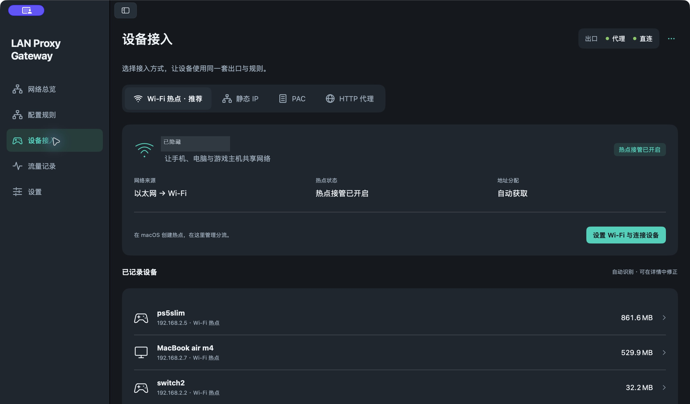

*图中已有设备，是正在使用中的环境。首次使用时设备列表为空属于正常情况；设备访问网络后才会出现。热点名称在图中已隐藏。*

### 3.2 在 macOS 创建热点

向导第一步点击 **打开系统共享设置**。也可以手动进入 **系统设置 → 通用 → 共享 → 互联网共享**，点击旁边的详情按钮。

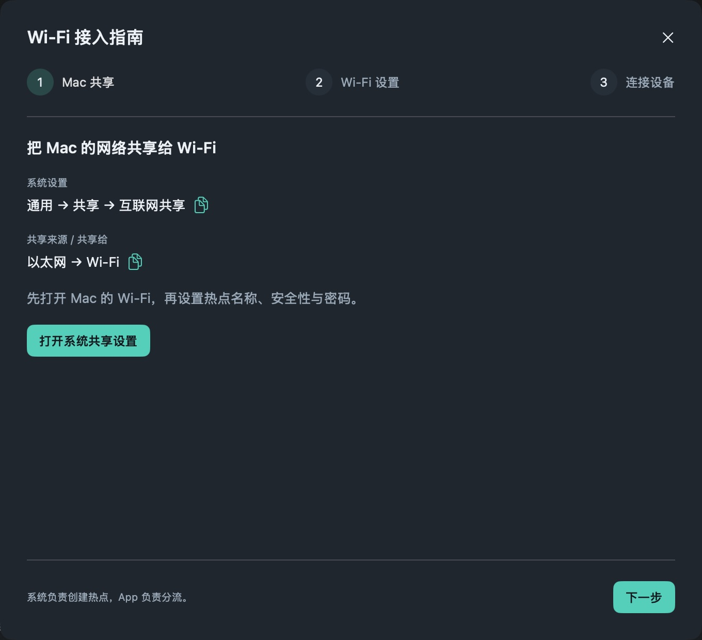

1. 先确保 Mac 的 Wi-Fi 已打开，并且网线能够上网。
2. 将“共享以下来源的连接”设为实际联网的 **以太网 / USB 以太网**。
3. 在“使用以下端口共享给设备”中选择 **Wi-Fi**。
4. 点 **Wi-Fi 选项**，设置网络名称、安全性、密码与信道。
5. 完成选项设置后，开启 **互联网共享**。

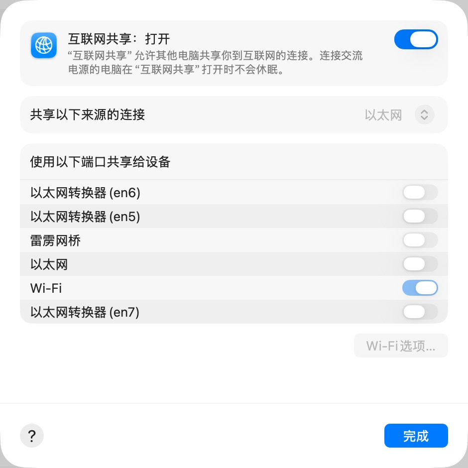

*这是共享已经开启后的实拍。来源、共享端口和 Wi-Fi 选项此时会变灰；要修改，先关闭互联网共享，改好后再打开。关闭期间热点设备会断网。不同 macOS 版本的文字和布局可能略有差异。*

### 3.3 Wi-Fi 选项怎样填

| 选项 | 第一次使用怎么填 |
|---|---|
| 网络名称 | 取一个自己认得出的名称，例如 `MyGateway` |
| 密码 | 设置至少 8 位的密码，接入设备连接热点时使用 |
| 安全性 | 有旧设备时优先选包含 WPA2 的兼容选项，例如系统提供的 WPA2/WPA3 个人级 |
| 信道 | 近距离可从系统提供的 5 GHz 信道 36 开始；设备找不到热点时尝试 2.4 GHz 的 1、6 或 11 |

App 向导第二步也能填写网络名称和密码备忘。**这里保存的是备忘，不会更改系统热点。实际生效的名称、密码、安全性和信道必须在 macOS 的 Wi-Fi 选项里设置。** 不需要备忘时可以直接继续。

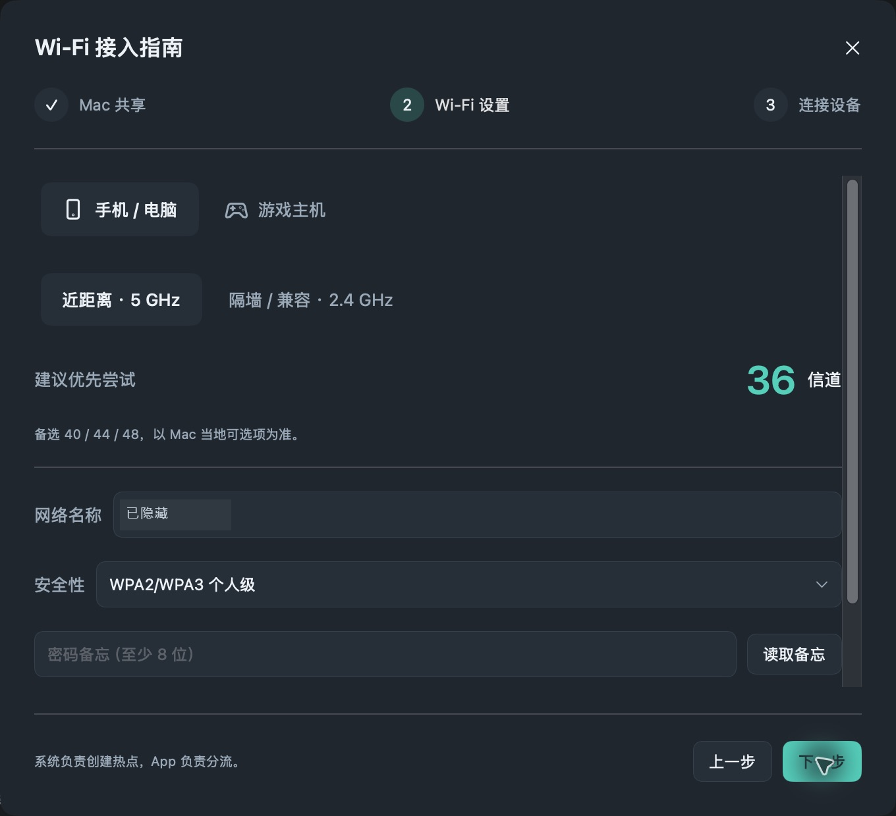

*截图中的热点名称已隐藏；没有读取或展示保存的密码。信道建议不保证所有地区、型号都兼容，最终以系统可选项与目标设备实测为准。*

### 3.4 回到 App 开启热点接管

继续到向导第三步，点击 **开启热点接管**，按提示完成授权，等待显示 **热点接管已开启**。

如果显示“等待共享网络”或未就绪，先检查 macOS 的互联网共享和 Wi-Fi 是否真的开启。不要通过改手机静态 IP 来绕过这一步。

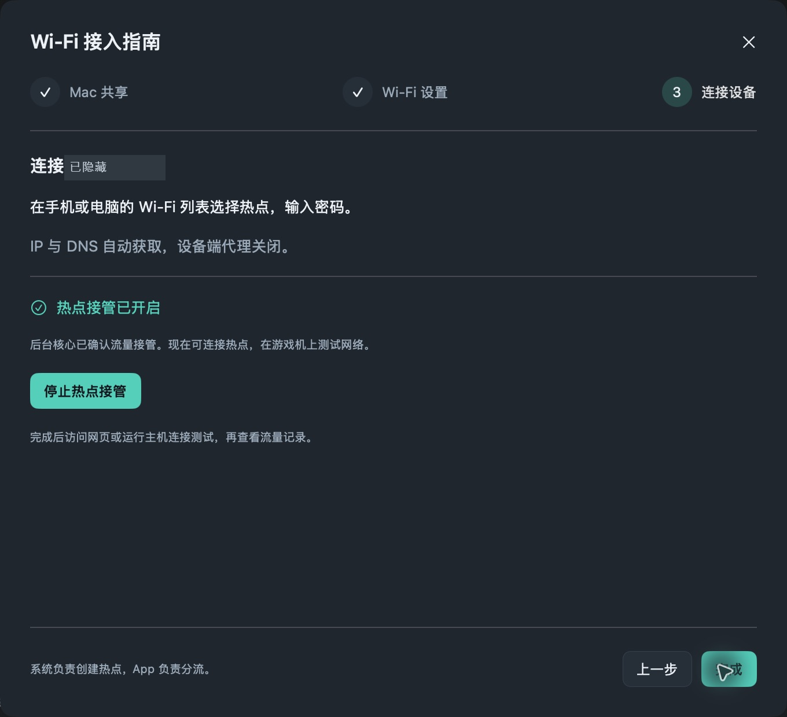

*已接管时按钮会变成“停止热点接管”，这是成功状态，不要为了完成教程再点一次。*

### 3.5 设备连接新热点

在手机、电脑、电视或游戏机上选择刚创建的 Wi-Fi，输入**系统热点密码**。这不是 HTTP 代理的用户名和密码。

| 接入设备 | 去哪里连接 | 网络参数 |
|---|---|---|
| iPhone / iPad | 设置 → Wi-Fi | 配置 IP 自动；DNS 自动；HTTP 代理关闭 |
| Android | 设置 → WLAN / Wi-Fi | IP 使用 DHCP / 自动；代理无 |
| PS5 | 设置 → 网络 → 设定 → 设定互联网连接 | IP 和 DNS 自动；DHCP 主机名不指定；代理不使用 |
| Nintendo Switch | 系统设置 → 互联网 → 互联网设置 | IP 和 DNS 自动；代理服务器关闭 |
| Apple TV / 智能电视 | 设置 → 网络 → Wi-Fi | IP 和 DNS 自动；选择新热点 |

以前手填过地址时，先改回自动；忘记该网络后重连也可清除旧配置。**热点路线不需要手填网关或 DNS。**

**检查点：** App 显示接管已开启，设备也连接到了 Mac 新建的热点。接下来必须做第 4 步，确认实际请求可用。

## 4. 确认真正接通了

1. 在接入设备打开一个普通网页，或运行游戏机的网络连接测试。
2. 再打开你实际需要的商店、网站或应用，确认能加载内容。联网测试成功不代表所有服务都可用。
3. 回到 **设备接入**，确认有这台设备的记录；点击设备可核对地址、名称和流量。
4. 打开 **流量记录**，选这台设备，查看刚才访问产生的新记录。搜索域名可以缩小范围。
5. 查看“出口”和“结果”：`PROXY` 是代理，`DIRECT` 是直连；“已响应”表示收到了数据。若想确认某服务走代理，需要检查对应连接的实际出口。

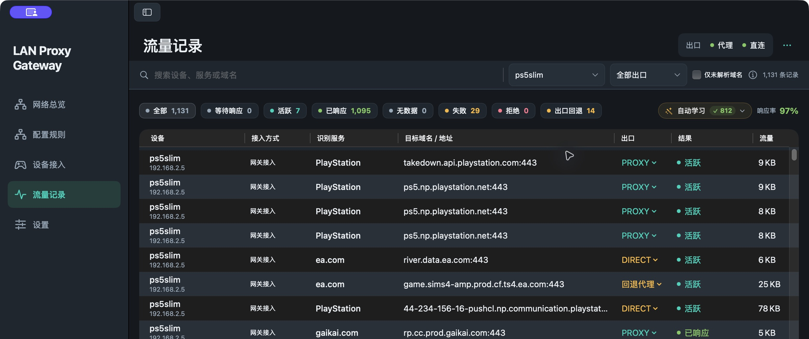

*记录来自实机，包含代理、直连、回退和失败。分流会让不同目标走不同出口，并不要求全部记录都显示 PROXY。*

| 你看到的现象 | 下一步 |
|---|---|
| 完全没有新记录 | 清除旧搜索/筛选；确认连的是 Mac 热点、核心运行、设备确实发起了访问 |
| 有记录，结果“已响应” | 再确认设备上的网页、商店或播放功能正常；收到数据不等于业务成功 |
| 某个目标“失败” | 点击对应记录查看详情，再检查上游或该域名规则 |
| 显示“拒绝” | 检查设备策略和分流规则是否主动拒绝 |
| 网页正常、游戏对战不行 | 可能涉及 UDP、NAT 或游戏服务，见 [联机问题](faq.md#gaming) |

到这里，首次设置完成。以后保持主机和代理软件运行，让设备连接这个热点即可。

## 5. 没有网线时：HTTP 代理接入

适合手机、电脑浏览器等**遵循代理设置的应用**。主机和设备仍需互相可达，通常连接同一个路由器。此方式不创建 Wi-Fi 热点，不改设备的网关或 DNS，也不接管任意 UDP。

### 5.1 在 App 打开共享代理

1. 先完成 [配置上游代理](#upstream)，并确认核心正在运行。
2. 打开 **设备接入 → HTTP 代理**（也可在 **设置 → 功能与接入** 找到相同设置）。
3. 开启 **启用代理服务**。端口默认 `17894`，也可使用未占用的其他端口。
4. 选择“无需认证”或“用户名和密码”。多人共享网络时可设置自己的用户名与密码；这是接入凭据，与上游代理账号独立。
5. 点击页面下方 **保存代理设置**，确认状态显示 **正在监听**。记下页面显示的服务器地址和已保存端口。

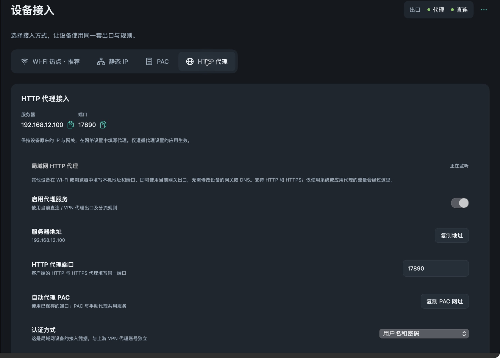

*本机已将端口改成 17890；这不是默认值。请使用你自己页面上的端口，不要照抄截图。*

### 5.2 在设备上填写

| 设备 / 软件 | 操作 |
|---|---|
| iPhone / iPad | 设置 → Wi-Fi → 当前网络右侧 ⓘ → 配置代理 → 手动；填服务器和端口，按需开启鉴定并填凭据 |
| Android | 当前 Wi-Fi 的编辑/高级设置 → 代理 → 手动；填主机名和端口，认证支持取决于系统或应用 |
| 其他电脑 / 浏览器 | 在系统或应用代理设置里填写 HTTP 代理；若 HTTP 和 HTTPS 分开填写，两者使用同一服务器和端口 |

设备 IP、路由器/网关、DNS 保持原有设置。若无法输入认证凭据，先确认客户端是否支持代理认证，不要把上游账号填到错误的位置。

完成后打开网页，并按 [第 4 步](#verify) 验证。HTTP 接入通常在记录中显示为“HTTP 代理”；某些应用会忽略系统代理，因此没有对应记录不能直接判定网关坏了。

### 5.3 认证与免密来源（按需使用）

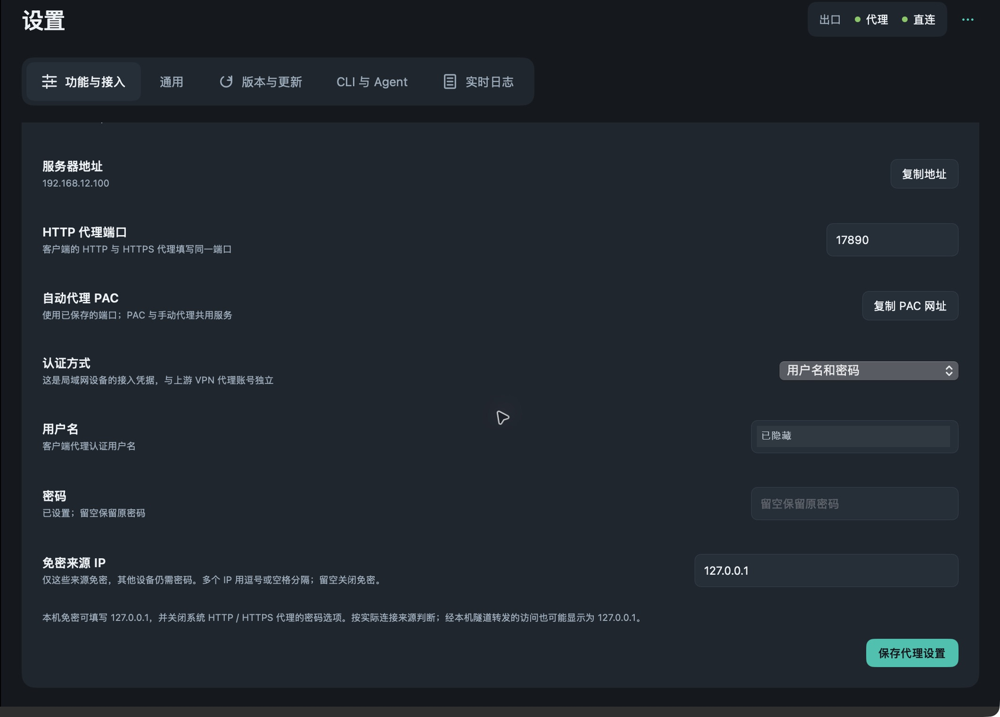

- 已有密码时，密码栏留空表示保留原密码；改为“无需认证”会清除接入凭据。
- v4.5.6 支持 **免密来源 IP**：只有列入名单的实际连接来源免密，其他来源仍需用户名和密码。新手可以留空。
- 名单填写准确的局域网或回环 IP，多个值用逗号或空格分隔；设备地址改变后需要重新核对。
- `127.0.0.1` 表示本机来源；通过本机隧道转发的访问也可能共享这个来源，不能用它区分隧道后的不同用户。
- HTTP Basic 应用于可信局域网；不要把管理 API 当成 HTTP 代理端口分享给设备。

## 6. 可选：PAC 自动代理

PAC 是设备下载的一段“如何选择代理”的配置。它与上面的 HTTP 代理共用一个监听器，**无需再开一个端口**。

1. 先完成 [HTTP 代理服务配置](#http)，保存并确认正在监听。
2. 打开 **设备接入 → PAC**，复制 PAC URL。也可用代理面板中的“复制 PAC 网址”。
3. 在接入设备选择“自动代理 / 自动代理配置”，粘贴 URL 并保存。例如 iPhone 的路径是“设置 → Wi-Fi → ⓘ → 配置代理 → 自动”。
4. 打开网页，并回“流量记录”验证。

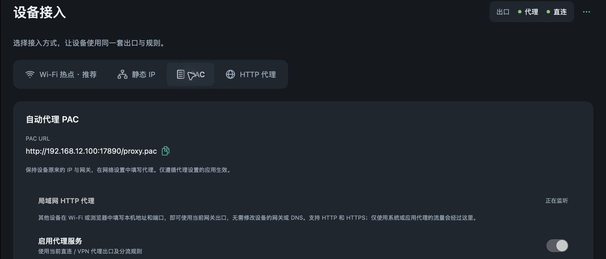

网址格式是 `http://电脑局域网IP:已保存端口/proxy.pac`。下载 PAC 不需要密码，真正使用代理时仍按认证设置检查。客户端不支持自动代理认证时，改用支持认证的手动 HTTP 代理。

PAC 仅影响遵循代理设置的应用；不意味着设备的所有流量都被接管，也不会在代理失效时自动添加客户端直连兜底。手机离开这台主机所在的网络后，应关闭该网络上的代理设置。

## 7. 进阶：原局域网中的静态网关接入

适合不创建热点、希望设备把网络流量交给常驻 Mac / Linux 处理的场景。需要理解自己网络的 IP、掩码和 DNS；第一次使用优先完成热点或 HTTP 路线。

**切换到静态网关会改变现有热点接管。** 两者共用同一套透明接入模式，不能把它们当作两个可以同时开启的独立开关。HTTP / PAC 可与其中一种共存。

1. 先记下设备原来的 IP、网关、DNS，方便恢复。主机和设备应在同一个可以互访的局域网中，避免访客网络隔离。
2. 在 App 的 **设备接入 → 静态 IP** 查看说明。若仍处于热点模式，选择“切换为静态网关接入”，等待核心确认。这个操作可能短暂中断当前设备连接。
3. 确认主机局域网 IP 稳定，最好在路由器中固定它。
4. 给设备选择同一子网内、确认未占用的静态地址，按下面填写。不要直接复制别人的地址。

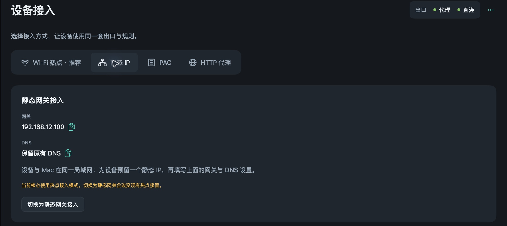

*图中仍在热点模式，因此仅展示入口与切换提醒，不是已完成静态网关配置的示例。*

| 设备上的字段 | 填什么 |
|---|---|
| IP 设置 | 手动 / 静态 |
| IP 地址 | 设备自己的空闲地址；每台设备不同，与主机在同一子网 |
| 子网掩码 / 前缀长度 | 沿用实际网络；`255.255.255.0` / `24` 仅是常见示例 |
| 网关 / 路由器 | 运行 LAN Proxy Gateway 的电脑局域网 IP |
| DNS | 使用网关 DNS 时，填主机 IP；默认静态接入没有 DNS 劫持，不能只改网关而仍绕过网关 DNS |
| HTTP 代理 | 无 / 不使用 |

**DNS 特别说明：** App 某些配置下会显示“保留原有 DNS”。这不是所有静态网关场景都适用的承诺。需要本网关还原域名并参与分流时，应确认网关 DNS 已启用且在局域网可达，再把客户端 DNS 指向主机。若刻意关闭网关 DNS，或使用 DoH/私人 DNS，部分连接只能识别 IP，域名分流和学习可能不完整；不要把热点自动获取参数照搬到静态网关。

例：仅当你的网络确实是 `192.168.1.0/24`，主机地址为 `192.168.1.10`，且 `.50` 未被占用时，设备可填 `192.168.1.50`、掩码 `255.255.255.0`、网关和 DNS `192.168.1.10`。第二 DNS 若不允许与第一项相同则留空。

保存后重新连接网络，按 [第 4 步](#verify) 验证。设备菜单详见 [手机](phone-setup.md)、[Switch](switch-setup.md)、[PS5](ps5-setup.md)、[Apple TV](appletv-setup.md)、[电视](tv-setup.md)。

## 8. 日常使用：只在需要时调整

### 8.1 看懂五个页面

| 页面 | 适合做什么 |
|---|---|
| 网络总览 | 看运行状态、在线设备、代理/直连用量、连接拓扑；向下滚动看出口卡片 |
| 设备接入 | 选择接入方式；点击已记录设备查看详情、修改设备名称或策略 |
| 流量记录 | 按设备、出口、结果、域名查具体连接；核对是不是走了代理 |
| 配置规则 | 编辑分流规则；管理自动学习 |
| 设置 | 功能与接入、通用、版本与更新、CLI 与 Agent、实时日志 |

“全部正常”是已观察出口的健康摘要，不保证所有网站或游戏都正常。“在线设备”是近期有流量的设备，不是路由器里的所有 Wi-Fi 客户端。

### 8.2 调整某台设备

在 **设备接入** 点击设备。根据需要选择默认、直连、代理或拒绝策略；默认表示继续按普通分流规则处理。设备策略优先于域名规则。若要恢复普通分流，改回默认。

设备按来源 IP 识别。DHCP 换地址后需要核对名称和策略归属；服务识别来自访问域名，不等于读取设备上安装的应用。强制代理也不等于获得通用 UDP 代理能力。

### 8.3 给一个网站加规则

第一次接入不需要先导入规则大全。确定某个目标有需求时再添加：

1. 打开 **配置规则 → 分流规则**。
2. 点击 **添加**，选择添加规则或预设；填写目标与动作。
3. “完整域名”只匹配这个主机；“域名后缀”包含其子域名，影响范围更大。不要填包含 `https://` 和路径的完整网址。
4. 选择代理、直连或拒绝。比如只对 `example.com` 设为代理，是一个说明格式的例子，不是必须添加的规则。
5. 点 **查看变更** 核对，再点 **应用规则**。仅编辑输入框并不会立即生效。
6. 重新发起连接，在流量记录确认出口。已有连接不会自动迁移。

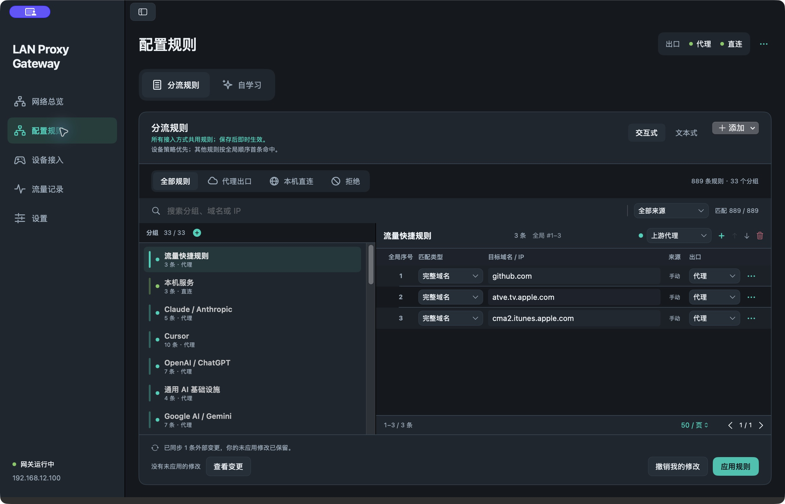

规则按全局顺序首次命中，设备策略优先。分组和搜索只是管理方式；筛选隐藏的规则仍然存在。若后台学习或其他工具同时更新规则，v4.5.6 会显示外部变更；真正冲突时逐项选择版本，合并到草稿后再应用。想放弃自己的草稿，可用“撤销我的修改”。

### 8.4 自动学习是什么

在 **配置规则 → 自学习**，或 **流量记录 → 自动学习** 打开。未命中明确规则的目标先直连；直连失败且代理收到响应后，按当前设置记录代理证据，达到次数阈值后自动保存或等待确认。

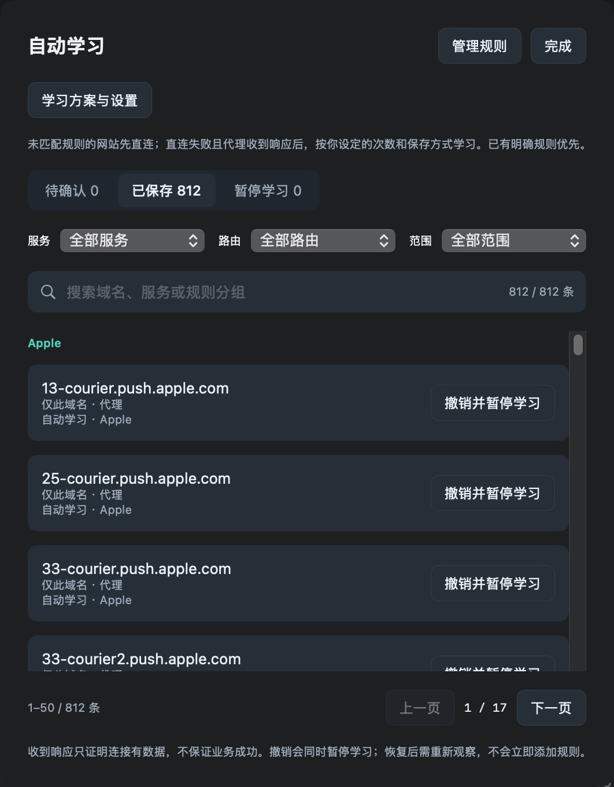

| 分类 / 操作 | 含义 |
|---|---|
| 待确认 | 已观察到候选，是否能保存仍受当前证据和规则约束 |
| 已保存 | 已加入规则；可按服务、方向和范围筛选 |
| 暂停学习 | 对该目标暂停积累学习证据，不是禁止访问 |
| 撤销并暂停学习 | 移除对应学习规则，同时暂停该目标后续学习 |
| 学习方案与设置 | 调整开启状态、确认次数、自动保存和等待时间 |

学习不保证业务成功，也不会覆盖所有显式规则。已有正常配置时，先使用默认设置即可；无需为了界面整齐，把大量精确域名合并成更宽的后缀规则。

### 8.5 流量为什么与服务商账单不同

网关只记录经过自身的转发字节。绕过本网关的设备流量、主机其他应用的代理流量，以及协议开销，不在相同统计口径内。

按天汇总的用量会保存；逐条连接记录在内存中最多保留 72 小时、2000 条，重启后不能作为长期审计记录。旧版未分类用量不能反推成代理或直连用量。

### 8.6 开机自启与 AI（可选）

开机自启在 **设置 → 通用** 中管理。还要保证上游代理软件可用；互联网共享、设备连接和主机唤醒也应单独检查。

想让本机 AI Agent 帮忙排障时，在 **设置 → CLI 与 Agent** 安装 CLI、导出 Skill ZIP，并复制安装说明交给支持 Skill 的 Agent。正常使用网关无需做这一步，也无需填写模型 API Key。

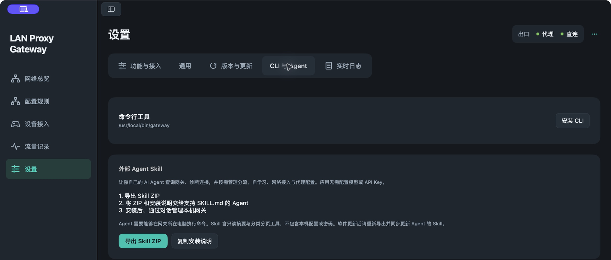

完整说明见 [外部 Agent Skill](agent-skill.md)。

## 9. 更新 App 和后台核心

1. 打开 **设置 → 版本与更新 → 检查更新**。
2. 发现新版后点 **下载并安装更新**，等待 App 重新打开。也可以用新版 DMG 替换“应用程序”中的 App。
3. 如果出现 **更新并重启核心** 或 **使用当前核心重启**，选择空闲时间执行。仅更新 App 不代表后台服务已经换成新版。
4. 回总览确认“网关运行中”，再用设备访问网页并检查新连接。
5. 使用 CLI / Agent 的用户同时更新对应核心和 Skill，避免旧工具覆盖新配置。

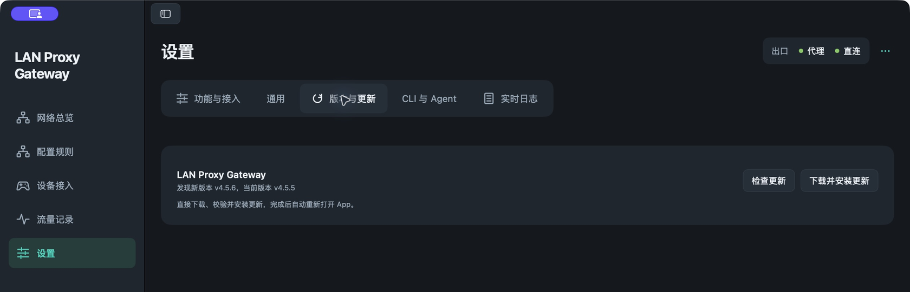

*此图记录的是更新前状态；截图过程中没有执行更新或重启核心。*

核心重启会短暂中断连接。升级前可在 **设置 → 通用 → 配置文件 → 在访达中显示** 找到实际配置并备份；配置含凭据，备份仅自己保存。v3 升级请先看 [迁移说明](migration-v4.md)。

## 10. 停止使用、恢复网络与卸载

关掉窗口或退出 App 不保证后台核心已停止。核心启停入口在右上角 **…**；要长期停用，还应在 **设置 → 通用** 关闭开机自启。

| 之前使用的方式 | 怎么恢复设备网络 |
|---|---|
| Wi-Fi 热点 | 设备切回原来的路由器 Wi-Fi；在 App 停止热点接管；不再需要热点时，在 macOS 关闭互联网共享 |
| HTTP 手动代理 | 在设备当前网络设置中关闭手动代理；IP、网关、DNS 不需要改 |
| PAC | 在设备网络设置中关闭自动代理 / 清除 PAC 地址 |
| 静态网关 | 把设备 IP、网关、DNS 改回原来的设置或 DHCP/自动，然后重连 |

“停止热点接管”只撤销网关的接管规则，macOS 可能仍通过热点提供普通直连网络；它不等于关闭 Wi-Fi 热点。

准备卸载时，先让接入设备恢复网络，再停止核心、关闭开机自启，最后删除“应用程序”中的 App。只删除 App 不会自动删除配置或停掉已安装的系统服务。CLI 用户可先执行 `sudo gateway service uninstall`、`sudo gateway stop`，再移除自己安装的可执行文件；配置保留或删除由你决定。

## 11. 出问题时按顺序检查

**主机能上网 → 上游代理测试成功 → 核心正在运行 → 接入方式确实启用 → 设备参数正确 → 新连接的实际结果。**

优先看 [按症状排查](faq.md)。寻求帮助时提供 App/核心版本、接入方式、错误文字和一条失败连接的脱敏截图；不要分享密码、订阅链接、`api-token` 或整份配置。若发不了网，先按上一节恢复原网络，再继续排查。
